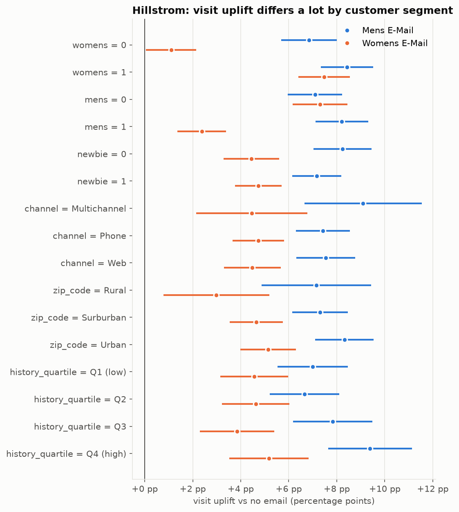
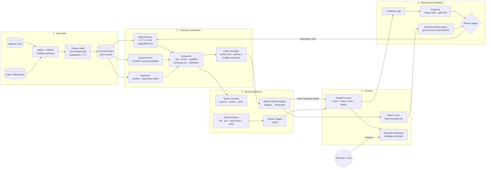

# Uplift Coupon Targeting: who should actually get the discount?

> An end-to-end causal ML system that predicts each customer's incremental response to a coupon and
> targets only the customers the coupon actually persuades. It includes experiment tracking, a model
> registry, CI/CD, monitoring and a live web demo.


**Live demo:** _coming soon_ · **API docs:** _coming soon_ · **Experiment dashboard:** _coming soon_

---

## 1. The business problem

Most companies send coupons to every customer, or to the customers a model says are **most likely to buy**.
That second approach is a *propensity* model, and it optimises for the wrong thing:

| Segment | Buys without coupon | Buys with coupon | Should we send a coupon? |
|---|---|---|---|
| **Persuadables** | ❌ | ✅ | **Yes.** This is the only group where the coupon creates revenue |
| **Sure things** | ✅ | ✅ | No. They would have bought anyway, so the discount is lost margin |
| **Lost causes** | ❌ | ❌ | No. It's wasted cost |
| **Sleeping dogs** | ✅ | ❌ | **Never.** The coupon or email drives them away |

A propensity model ranks *sure things* at the top, which is exactly where the margin is wasted.
An **uplift model** estimates the *Conditional Average Treatment Effect* (CATE):

```
uplift(x) = P(buy | x, coupon) − P(buy | x, no coupon)
```

It ranks customers by how much the coupon **changes** their behaviour, so the campaign budget goes to the persuadables.

**Headline result (to be filled in):** targeting the top **k %** of users by predicted uplift captures **X %** of the
incremental conversions at **Y %** of the coupon cost, which saves **₹Z per 1 lakh users** compared with blanket targeting.

---

## 2. Datasets

| Dataset | Size | Treatment | Outcomes | Role in this project |
|---|---|---|---|---|
| [Hillstrom MineThatData Email](https://blog.minethatdata.com/2008/03/minethatdata-e-mail-analytics-and-data.html) | 64,000 customers | Men's email / Women's email / No email (randomised, 1/3 each) | visit, conversion, **spend** | Main development dataset. It has spend, so we can do real ₹ profit modelling and interpret features |
| [Criteo Uplift v2.1](https://huggingface.co/datasets/criteo/criteo-uplift) (CC BY-NC-SA 4.0) | 13,979,592 users, 12 anonymised features | Ad exposure randomised, about 85% treated / 15% control | visit, conversion | Scale benchmark that shows the pipeline works on production-sized data |

Both datasets come from **randomised controlled trials**, so the treatment assignment is independent of the features.
That is the assumption that lets us read the uplift estimates causally.

> ⚠️ **Leakage trap:** Criteo's `exposure` column is a *post-treatment* variable. It must never be used as a feature.
> The pipeline enforces this: `assert_no_leakage` fails the run if any post-treatment column is in the feature list.

### Data validation (Phase 1)

Every run checks that the experiment itself is trustworthy before any model is trained (`make validate`):

| Check | Hillstrom | Criteo (full 14M) |
|---|---|---|
| Schema contract (Pandera, incl. *conversion ⇒ visit*, *control never exposed*) | ✅ | ✅ |
| Row count matches published dataset | ✅ 64,000 | ✅ 13,979,592 |
| Sample-ratio mismatch (χ² test of arm sizes) | ✅ p = 0.90 | ✅ p = 0.999 |
| Covariate balance, max \|SMD\| < 0.1 | ✅ 0.009 | ✅ 0.049 |
| Post-treatment leakage guard | ✅ | ✅ |
| Average effect on visit (95% CI) | Men's email +7.66 pp [6.99, 8.32]; Women's +4.52 pp [3.89, 5.16] | +1.03 pp [1.01, 1.06] |

The Hillstrom lifts reproduce the published MineThatData results exactly, and a test fails CI if they drift.

### The case for uplift modelling, in one chart



The women's email lifts visits by **+7.5 pp** for past women's-wear buyers but only **+1.1 pp** for everyone else, who are 45% of the customer base.
Blanket sending wastes almost half the sends. Finding these differences one customer at a time is the uplift model's job.
Full analysis: [`notebooks/01_eda.ipynb`](notebooks/01_eda.ipynb).

---

## 3. Architecture



See [`docs/ARCHITECTURE.md`](docs/ARCHITECTURE.md) for the component-level design, the serving sequence and the
deployment topology. See [`docs/ROADMAP.md`](docs/ROADMAP.md) for the phase-by-phase build plan.

---

## 4. Tech stack

| Layer | Tools |
|---|---|
| Causal ML | `econml` (CausalForestDML, X/DR-learner), `causalml` (optional: uplift trees), `scikit-uplift` (metrics, datasets) |
| Base learners | LightGBM, scikit-learn |
| Data & validation | pandas / polars, pyarrow, Pandera, **DVC** |
| Experiment tracking | **MLflow** (tracking and model registry; hosted free on DagsHub) |
| Orchestration | Prefect (or a `Makefile` + DVC pipeline for the minimal version) |
| Serving | **FastAPI**, Pydantic v2, Uvicorn |
| Frontend | **Streamlit** (campaign simulator) |
| Monitoring | **Evidently**, structured JSON logs |
| CI/CD | **GitHub Actions**, Docker, GitHub Container Registry |
| Hosting | Hugging Face Spaces (Streamlit), Render / HF Docker Space (API) |
| Quality | pytest, ruff, mypy, pre-commit |

---

## 5. Repository layout (target)

```
uplift/
├── configs/                 # Hydra/YAML configs: data, model, policy (coupon cost, margin)
├── data/                    # DVC-tracked (raw/, interim/, processed/). Not committed to git
├── docs/
│   ├── ARCHITECTURE.md
│   └── ROADMAP.md
├── notebooks/               # EDA + model comparison (exploration only, no logic lives here)
├── src/uplift/
│   ├── data/                # download.py, schemas.py, validate.py, split.py, stats.py, eda.py
│   ├── features/            # build_features.py
│   ├── models/              # meta_learners.py, causal_forest.py, baselines.py, registry.py
│   ├── evaluation/          # qini.py, uplift_curves.py, calibration.py, bootstrap.py
│   ├── policy/              # simulator.py (profit curve, optimal k, budget)
│   ├── serving/             # api.py (FastAPI), schemas.py, model_loader.py
│   └── monitoring/          # drift.py, holdout_report.py
├── app/                     # Streamlit dashboard
├── pipelines/               # Prefect flows / dvc.yaml stages
├── tests/                   # unit + integration + model-quality gates
├── docker/                  # Dockerfile.api, Dockerfile.app
├── .github/workflows/       # ci.yml, train.yml, deploy.yml
├── dvc.yaml
├── pyproject.toml
├── Makefile
└── README.md
```

---

## 6. Evaluation methodology

Uplift can't be observed for a single person, because nobody both receives and doesn't receive the coupon.
Models are therefore evaluated on **groups** in a held-out randomised test set:

- **Qini curve and Qini coefficient**: the cumulative incremental conversions gained when users are targeted in order of predicted uplift, compared with random targeting.
- **Uplift curve / AUUC**: area under the cumulative uplift curve.
- **Uplift@k**: the observed treated-minus-control conversion rate inside the top k% of users.
- **Decile calibration**: predicted versus observed uplift per decile. A good model is monotonic and well calibrated.
- **Bootstrap 95% confidence intervals** on every metric, so we don't declare a winner on noise.
- **Propensity-model baseline**, which shows numerically why "most likely to buy" ≠ "most persuadable".

### Policy simulation

```
incremental_profit(k) = Σ_{i ∈ top k%} [ uplift_i × margin  −  coupon_cost × P(redeem_i) ]
```

The dashboard sweeps k from 0 to 100% and shows **profit compared with blanket targeting** and the **profit-maximising k**,
with an optional budget cap. Coupon cost and margin are user inputs.

---

## 7. Results

| Model | Qini coef. (Hillstrom) | AUUC | Uplift@30% | Qini (Criteo) | Train time |
|---|---|---|---|---|---|
| Random | – | – | – | – | – |
| Propensity (LightGBM) | – | – | – | – | – |
| S-learner | – | – | – | – | – |
| T-learner | – | – | – | – | – |
| X-learner | – | – | – | – | – |
| DR-learner | – | – | – | – | – |
| Causal Forest | – | – | – | – | – |

_Table filled in automatically from MLflow runs. See `make report`._

---

## 8. Quickstart

> Requires [uv](https://docs.astral.sh/uv/). The project pins **Python 3.11**, because EconML wheels lag behind the newest Python releases; uv downloads it automatically.
> On macOS, LightGBM needs OpenMP: `brew install libomp`.

```bash
git clone https://github.com/<your-username>/uplift.git && cd uplift
make install      # uv creates .venv: Python 3.11, causal-ML stack, dev tools
make hooks        # pre-commit: ruff, mypy, large-file guard
make data         # DVC pipeline: download (Hillstrom + full Criteo, ~311 MB) -> validate -> split
make eda          # re-run the EDA notebook, refresh reports/figures/
make check        # lint + typecheck + fast tests (same as CI)
make test-all     # include the full-Criteo data tests

# coming in later phases
make train       # train all models, log to MLflow
make evaluate    # Qini / uplift curves + policy simulation
make serve       # FastAPI on :8000   (docs at /docs)
make app         # Streamlit on :8501
```

---

## 9. API (planned)

```http
POST /score
{ "recency": 6, "history": 329.08, "mens": 1, "womens": 0, "zip_code": "Surburban", "newbie": 0, "channel": "Web" }

→ { "uplift": 0.041, "segment": "persuadable", "recommend_coupon": true, "model_version": "t_learner_lgbm@v3" }
```

`POST /batch_score` takes a parquet or CSV upload and returns a ranked campaign list.
`POST /policy` takes cost, margin and budget, and returns the optimal k and the expected incremental profit.

---

## 10. Roadmap

- [x] Phase 0: Repo scaffold, tooling, CI skeleton
- [x] Phase 1: Data ingestion, validation, EDA, ATE sanity check
- [ ] Phase 2: Baselines + meta-learners + causal forest
- [ ] Phase 3: Evaluation suite + policy simulator
- [ ] Phase 4: MLflow tracking, registry, DVC pipeline
- [ ] Phase 5: FastAPI service + Docker + tests
- [ ] Phase 6: Streamlit dashboard + public deployment
- [ ] Phase 7: Monitoring, drift detection, retraining flow
- [ ] Phase 8: Criteo 14M scale run + write-up / blog post

Details: [`docs/ROADMAP.md`](docs/ROADMAP.md)

---

## 11. References

- Radcliffe & Surry, *Real-World Uplift Modelling with Significance-Based Uplift Trees* (2011)
- Künzel et al., *Meta-learners for Estimating Heterogeneous Treatment Effects* (PNAS, 2019)
- Wager & Athey, *Estimation and Inference of Heterogeneous Treatment Effects using Random Forests* (JASA, 2018)
- Diemert et al., *A Large Scale Benchmark for Uplift Modeling* (Criteo AI Lab, 2018)
- Gutierrez & Gérardy, *Causal Inference and Uplift Modeling: A Review of the Literature* (2017)

## License

MIT
