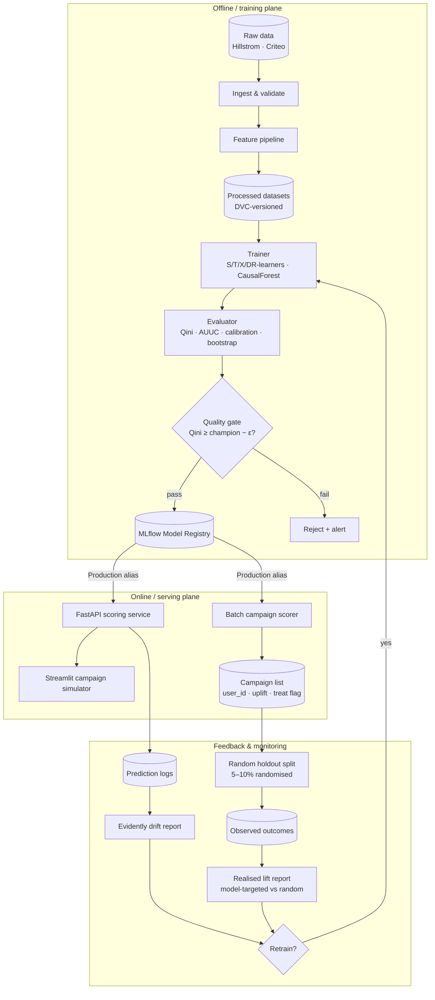
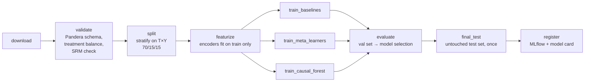
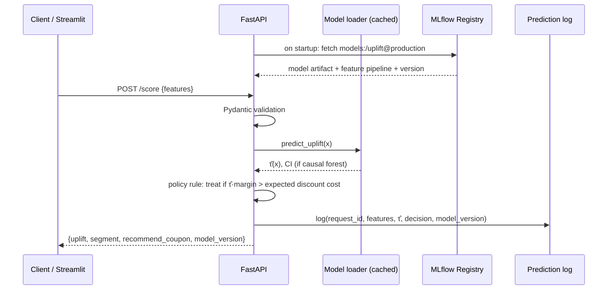
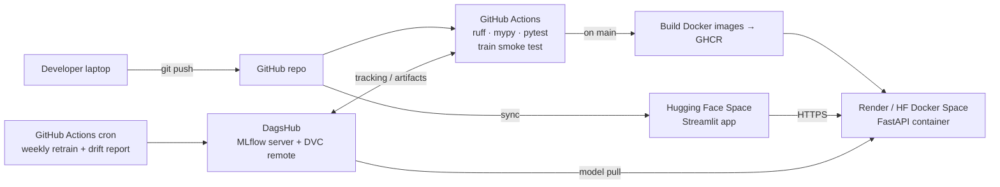

# Architecture

This document describes how the uplift targeting system is put together: the offline training plane, the online
serving plane, and the feedback loop that keeps the model honest after deployment.

## 1. Design principles

1. **Uplift, not propensity.** Every model, metric and dashboard number is about *incremental* outcome.
2. **Always keep a random holdout.** In production, 5–10% of eligible users are randomised into treatment and control regardless of the model.
   That is the only way to (a) measure true incremental lift and (b) collect unbiased training data for the next model.
   A model trained only on its own targeted users learns from a biased sample.
3. **Batch first, real-time second.** Coupon campaigns are planned daily or weekly, so the main path is a batch scorer. The REST API exists for
   on-demand scoring and for the demo.
4. **Reproducibility.** Any registered model can be traced back to a git commit, a DVC data hash and an MLflow run.
5. **Free-tier deployable.** Every component runs on free hosting so the demo stays online for recruiters.

## 2. System context

## 3. Training pipeline (DVC stages / Prefect flow)

Notes:

- **SRM (sample ratio mismatch) check:** confirm the treatment/control ratio matches the design (1/3 per arm for Hillstrom, ~85/15 for Criteo). If it doesn't, the randomisation is suspect.
- **ATE sanity check:** the simple difference in means `mean(Y|T=1) − mean(Y|T=0)` must roughly match the mean predicted CATE.
- **Criteo scale strategy:** meta-learners with LightGBM train on the full 14M rows. Causal forest trains on a stratified 1–2M subsample, because it is memory-bound. The benchmark reports the cost/accuracy trade-off.
- **Hillstrom multi-treatment:** model *Men's email vs none* and *Women's email vs none* separately, or use EconML's multi-treatment support. The policy then picks the best arm per user.

## 4. Model layer

| Model | Idea | Strength | Weakness |
|---|---|---|---|
| S-learner | One model with T as a feature | Simple | Tree models often ignore T, so uplift shrinks to 0 |
| T-learner | Separate models for treated and control | Easy, strong baseline | Errors from the two models add up; weak when one arm is small (Criteo control = 15%) |
| X-learner | Imputes individual effects, weighted by propensity | Handles imbalanced arms well | More moving parts |
| DR-learner | Doubly robust pseudo-outcome regression | Low bias, principled | Needs cross-fitting |
| Causal Forest (DML) | Honest forest that splits on effect heterogeneity | Confidence intervals per user, interpretable | Slow and memory-heavy at 14M |

The randomised propensity is **known** (e.g. 0.85 on Criteo), so it is passed as a constant rather than estimated.

## 5. Serving

Endpoints:

| Method | Path | Purpose |
|---|---|---|
| GET | `/health` | Liveness + loaded model version |
| POST | `/score` | Single user → uplift + decision |
| POST | `/batch_score` | File upload → ranked campaign list |
| POST | `/policy` | cost, margin, budget → optimal k, expected profit, profit curve |
| GET | `/metrics` | Prometheus-style counters (requests, latency) |

## 6. Deployment topology (free tier)

## 7. Monitoring

| Signal | Tool | Action |
|---|---|---|
| Feature drift (PSI / KS per feature) | Evidently | Report + alert if PSI > 0.2 |
| Prediction drift (distribution of τ̂) | Evidently | Alert if the share of predicted persuadables shifts sharply |
| Realised incremental lift (holdout) | Custom report | Retrain if model-targeted lift < random-targeted lift |
| Latency / error rate | FastAPI middleware logs | Alert on p95 > 200 ms or 5xx > 1% |

## 8. Known risks

- **Post-treatment leakage**: Criteo `exposure` and anything else measured after the coupon must not be used as a feature.
- **Small effects, noisy metrics**: Criteo conversion is about 0.3%, so the differences between models need bootstrap CIs.
- **Feedback loop bias**: without the random holdout, retraining on targeted users degrades the model over time.
- **Offline ≠ online**: Qini on historical RCT data is a proxy. The real validation is an online A/B test of model targeting against blanket targeting.
